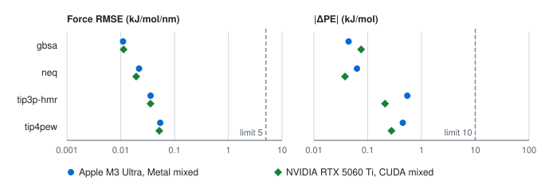
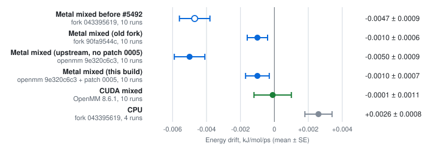
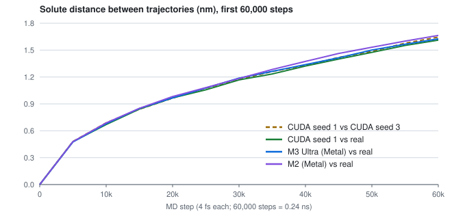
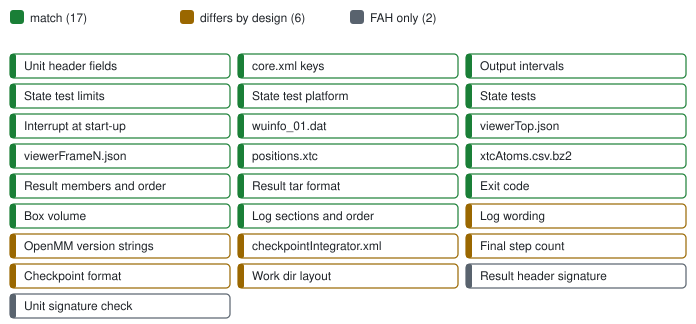
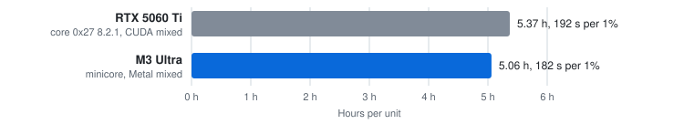

# fah-core-metal

A real, fully working Folding@home core for Apple Silicon GPUs.

People have asked for Folding@home on Apple GPUs since 2019
([openmm#2489](https://github.com/openmm/openmm/issues/2489)) and 2024
([fah-client-bastet#303](https://github.com/FoldingAtHome/fah-client-bastet/issues/303)). Here it is.
minicore runs Folding@home's own OpenMM work units end to end on the Mac's GPU, through OpenMM's Metal
platform, and folds them to the standard of FAH's own core.

| | Checked against FAH's core 0x27 |
| ---: | --- |
| **21 of 21** | state tests passed on a whole real FAH unit (P18264, 919,221 atoms, 5 ns), as FAH's core 0x27 passed 21 |
| **Six files** | in the result, in core 0x27's order; viewerTop.json, xtcAtoms.csv.bz2 and checkpointIntegrator.xml byte-identical to core 0x27's |
| **101 of 101** | core-parity checks passed, and 65 of 65 failure and stop-resume cases |
| **0.054** | worst state-test force RMSE in kJ/mol/nm, beside CUDA's 0.052, against FAHBench's limit of 5 |
| **16 s** | to fold the bundled test unit on an M3 Ultra after `./build.sh`, so you can check it yourself ([Try it](#try-it)) |

## Accuracy

<picture>
  <source media="(prefers-color-scheme: dark)" srcset="docs/figures/accuracy-dark.svg">
  
</picture>

*Worst state-test errors, Metal beside CUDA, far inside FAHBench's limits.*

<picture>
  <source media="(prefers-color-scheme: dark)" srcset="docs/figures/drift-dark.svg">
  
</picture>

*Energy drift in NVE, 10 runs each, Metal beside CUDA (Welch t -0.7).*

<picture>
  <source media="(prefers-color-scheme: dark)" srcset="docs/figures/distance-dark.svg">
  
</picture>

*Metal parts from FAH's trajectory as fast as two CUDA runs part from each other.*

## Parity with FAH's core

<picture>
  <source media="(prefers-color-scheme: dark)" srcset="docs/figures/parity-dark.svg">
  
</picture>

Every behaviour FAH's client acts on matches core 0x27. The rest needs FAH's own signing keys or is a
format the client never reads. [docs/PARITY.md](docs/PARITY.md) lists every row.

## Speed

| Machine | Core | Per 1% | Per unit |
| --- | --- | ---: | ---: |
| Apple Silicon, M3 Ultra | minicore, Metal | 182 s | 5.06 h |
| NVIDIA RTX 5060 Ti | FAH's core 0x27, CUDA | 192 s | 5.37 h |

<picture>
  <source media="(prefers-color-scheme: dark)" srcset="docs/figures/speed-dark.svg">
  
</picture>

*Hours per whole P18264 unit.*

### Also on NVIDIA

minicore built for CUDA (OpenMM 8.6.1) ran the unit's first 11% on the same card at 180 s per 1%,
against FAH's core's 187 s. On a 5,000-step cut its viewerTop.json and xtcAtoms.csv.bz2 were
byte-identical to FAH's core's ([run conditions](docs/EVIDENCE.md#speed)).

## Try it

On Apple Silicon with macOS 15 or later, Xcode or the Command Line Tools, git and CMake:

```sh
git clone https://github.com/RedesignedRobot/fah-core-metal.git
cd fah-core-metal
./build.sh
cp -R test/alanine-dipeptide unit
./build/core/minicore -dir unit -gpu-vendor apple -gpu 0; echo "exit $?"
```

The fold logs to `unit/logfile_01.txt`, exits 100 (FINISHED_UNIT) and writes its result to
`unit/wuresults_01.dat`.

## Build it

`./build.sh [-j JOBS] [OUT]` fetches OpenMM with the Metal platform at a pinned commit and links
`OUT/core/minicore`, one self-contained executable. OUT, `./build` by default, must not exist:

```sh
rm -rf build
./build.sh
```

## FAQ

### Is it as accurate as FAH's core?

Yes. It passed all 21 of the unit's state tests, as FAH's core did, and its errors and drift sit with
CUDA's.

### Can Folding@home use the Apple Silicon GPU?

Yes. minicore runs FAH's real work units on it.

### How fast is it against NVIDIA?

On P18264 minicore took 5.06 h on an M3 Ultra, and FAH's core took 5.37 h on an RTX 5060 Ti.

### Can I fold for Folding@home points with it today?

No. FAH signs its cores and their results with its own private key, so that step is FAH's.

## Credits

- [OpenMM](https://openmm.org), by Peter Eastman and the OpenMM contributors, does the molecular dynamics.
- Peter Eastman's Metal platform for OpenMM, [openmm#5488](https://github.com/openmm/openmm/pull/5488),
  is the GPU backend.
- Andrew Thall's "Extended-Precision Floating-Point Numbers for GPU Computation" (2006) describes the
  double-float arithmetic behind the df64 mixed precision.
- [Folding@home](https://foldingathome.org) defines the work units, the client and core 0x27 that this
  core is checked against. Its FAHBench state tests are the ones minicore runs.

## License

The code in this repo is under the MIT License (`LICENSE`). OpenMM's code keeps OpenMM's licenses and
notices. The patches in `patches/` edit OpenMM's files and carry OpenMM's license for them, and
`build.sh` fetches OpenMM's tree. The Metal platform and the xdrfile code linked into minicore are under
the LGPL 3 or later, Apple's metal-cpp header compiled into it under the Apache License 2.0, and the xtc
writer from OpenMM's tree under the MIT License. `NOTICE` lists each part.

fah-core-metal is not affiliated with or endorsed by Folding@home. It never connects to FAH servers. It
reads a work unit from a directory and writes its result into that directory.

Built and tested with Claude Opus 5.5.
