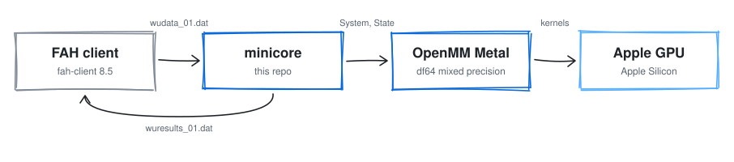
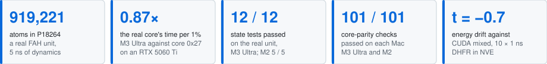

# fah-core-metal

A Folding@home core that runs real FAH work units on Apple Silicon GPUs through OpenMM's Metal platform.

<picture>
  <source media="(prefers-color-scheme: dark)" srcset="docs/figures/hero-dark.svg">
  
</picture>

*Figure 1. The path of a work unit: the FAH client hands minicore a unit directory, minicore builds the
OpenMM System and State from it, OpenMM's Metal platform runs the kernels on the GPU, and the result tar
goes back to the client.*

minicore is a Folding@home core for Apple Silicon Macs. It folds FAH's OpenMM work units on the Mac's GPU
with OpenMM's Metal platform in df64 mixed precision, and writes the result files FAH's CUDA core 0x27
writes. On one real unit, project 18264 with 919,221 atoms, the M3 Ultra takes 0.87 times core 0x27's time
per 1% on an RTX 5060 Ti. Its state-test errors sit beside CUDA mixed precision's, and in 10 runs its
energy drift can't be told apart from CUDA mixed's.

Runs on Apple Silicon Macs (M-series GPUs) through Metal. Tested on the M3 Ultra and the M2.

Background: [openmm#2489](https://github.com/openmm/openmm/issues/2489), "Future of osx GPU support"
(2019-11-28), and [fah-client-bastet#303](https://github.com/FoldingAtHome/fah-client-bastet/issues/303),
"Support for Apple's integrated GPUs" (2024-11-05).

<picture>
  <source media="(prefers-color-scheme: dark)" srcset="docs/figures/results-dark.svg">
  
</picture>

## Results at a glance

| Result | Shown in |
| --- | --- |
| On P18264 the M3 Ultra takes 167 s per 1% and 4.66 h per unit. Core 0x27 on an RTX 5060 Ti takes 192 s and 5.37 h. | Figures 2, 3 |
| The Metal trajectory parts from the real one as fast as two CUDA seeds part from each other: 0.475 nm against 0.481 nm at step 5,000. | Figure 4 |
| A CUDA replay samples the real run's box volume, 9,307.1 nm³ mean for both, so the trajectories that part still sample one ensemble. | Figure 5 |
| On four test systems the worst state-test force RMSE is 0.054 kJ/mol/nm on Metal and 0.052 on CUDA mixed, against a limit of 5. | Figure 6 |
| Energy drift in NVE is -0.0010 ± 0.0006 kJ/mol/ps on Metal and -0.0001 ± 0.0011 on CUDA mixed (Welch t -0.7). | Figure 7 |
| 17 of 25 files and behaviours match core 0x27 on both Macs. 6 differ where FAH's design decides, and 2 need FAH's keys. | Figure 8 |
| 101 of 101 core-parity checks pass on each Mac, and every state test on the real unit passes. | [What was tested](#what-was-tested-and-where) |

## Speed

P18264 run 153 clone 0 gen 272: 919,221 atoms, 1,250,000 steps of 4 fs (5 ns), PME, a Monte Carlo
barostat and mixed precision. One 1% is 12,500 steps.

| Machine | Core | Time per 1% | Time per unit |
| --- | --- | ---: | ---: |
| RTX 5060 Ti, Linux | core 0x27 8.2.1 (OpenMM 8.2.0, CUDA mixed), a real FAH run | 192 s | 5.37 h |
| M3 Ultra, macOS 27 | minicore, Metal mixed | 167 s | 4.66 h |

<picture>
  <source media="(prefers-color-scheme: dark)" srcset="docs/figures/speed-dark.svg">
  
</picture>

*Figure 2. Hours per P18264 unit: core 0x27 from the real run's wall clock, minicore from 100 times its
median 1% interval plus start-up and checkpoints (`docs/data/speed.csv`).*

<picture>
  <source media="(prefers-color-scheme: dark)" srcset="docs/figures/progress-dark.svg">
  
</picture>

*Figure 3. Seconds per 1% interval: core 0x27 from the times of its 100 viewer frames across the unit,
the M3 Ultra from the times of its progress lines over the first 5% (`docs/data/progress.csv`).*

The M3 Ultra takes 0.87 times the real core's time per 1%. Each figure, its run and its conditions are
in [docs/EVIDENCE.md](docs/EVIDENCE.md).

## Does it fold the same science?

No two runs of this unit share a trajectory, on any platform. The unit's integrator has randomSeed 0,
which OpenMM reads as "pick a new seed for each Context". So I compared minicore's trajectory with the
real one the way two CUDA runs compare with each other. I replayed the unit twice with OpenMM 8.2.0 in
CUDA mixed precision on the same model of card, with seeds 1 and 3.

<picture>
  <source media="(prefers-color-scheme: dark)" srcset="docs/figures/distance-dark.svg">
  
</picture>

*Figure 4. RMS distance between the 2,520 solute atoms of two runs every 5,000 steps, minimum image and
no fitting: each run against the real one, and CUDA seed 1 against CUDA seed 3
(`docs/data/distance.csv`).*

At step 5,000, the first frame anyone writes, the M3 Ultra's solute is 0.475 nm from the real one and the
M2's 0.479 nm. The two CUDA seeds are 0.481 nm from each other. Metal parts from the real run as fast as
CUDA parts from itself.

<picture>
  <source media="(prefers-color-scheme: dark)" srcset="docs/figures/volume-dark.svg">
  
</picture>

*Figure 5. Box volume at each of the 250 XTC frames of the unit, the real run and the CUDA replay with
seed 3 (`docs/data/volume.csv`).*

Over the whole unit the CUDA replay samples the same box volume as the real run: a mean of 9,307.1 nm³
for both, with a standard deviation of 5.9 for the real run and 6.2 for the replay. Over the first 62,500
steps, the part all four runs share, every run's box stays between 9,299 and 9,317 nm³.

## Accuracy and energy conservation

Core 0x27 checks the GPU against the CPU platform with FAHBench's state test: forces and energies
from the same positions, within limits. I ran it on four test systems at step 0 and at five checkpoints,
on Metal and on CUDA mixed precision, against OpenMM's Reference platform.

<picture>
  <source media="(prefers-color-scheme: dark)" srcset="docs/figures/accuracy-dark.svg">
  
</picture>

*Figure 6. Worst of six state tests per test system against OpenMM's Reference platform, on a log scale
with FAHBench's limits dashed: Metal mixed on each Mac, and CUDA mixed (OpenMM 8.6.1) on an RTX 5060 Ti
(`docs/data/accuracy.csv`).*

The test systems are gbsa (2,489 atoms, implicit solvent), neq (2,269 atoms, a nonequilibrium
CustomIntegrator), tip3p-hmr (29,451 atoms, PME, 4 fs) and tip4pew (38,876 atoms, PME, virtual sites).
All 72 tests passed. The largest force RMSE is 0.054 kJ/mol/nm on Metal and 0.052 on CUDA, against a
limit of 5. The largest |ΔPE| is 0.61 kJ/mol on Metal and 0.28 on CUDA, against a limit of 10.

<picture>
  <source media="(prefers-color-scheme: dark)" srcset="docs/figures/drift-dark.svg">
  
</picture>

*Figure 7. Energy drift of DHFR (23,558 atoms) over 1 ns of NVE at 2 fs: the least-squares slope of each
run's total energy, mean ± SE over independent runs (`docs/data/drift.csv`).*

Metal mixed at the OpenMM commit `build.sh` pins drifts -0.0010 ± 0.0006 kJ/mol/ps. CUDA mixed, the
precision core 0x27 runs, drifts -0.0001 ± 0.0011, and 10 runs each can't tell the two apart (Welch t
-0.7). Before openmm#5492 fixed how OpenMM rewraps molecules, Metal mixed drifted -0.0047 ± 0.0009.

## What was tested and where

- **The real core.** fah-client 8.5.6 ran core 0x27 8.2.1 on an RTX 5060 Ti under Linux and folded the
  whole unit on 2026-10-15 in 5.37 h. Its files are the reference for every check below. I also replayed
  the unit with OpenMM 8.2.0 in CUDA mixed precision on the same model of card.
- **minicore on the M3 Ultra and the M2, under macOS 27.** Each Mac ran the real unit to step 62,500 and
  ran shortened copies to the end, which writes the result files. Every state test on the real unit
  passed: 12 of 12 on the M3 Ultra and 5 of 5 on the M2, with none failed.
- **101 core-parity checks on each Mac.** These cover four smaller test systems and every path a FAH
  core has to survive: a straight run, a pause and resume, SIGKILL, a NaN, a stalled GPU, repeated
  failures, a unit that fails its first test, a corrupted checkpoint, a dead client and bad arguments.
  All 101 passed on both Macs. Across their 27 logs per Mac, 156 state tests passed and 1 failed, on the
  unit that sets its energy limit to 1e-9 so that its first test must fail.
- **This repo's build.** A fresh clone of this repo built with `./build.sh` folds the test unit in
  `test/`, and resumes after a stop to the same 101 viewer frames and 100 XTC frames as a straight run.
  On each Mac it ran P18264 from its input and a 5,000-step copy of it to the end. Its viewerTop.json and
  xtcAtoms.csv.bz2 are byte-identical to the real core's, the result tar holds the same six members, and
  all its state tests passed: 5 of 5 on the M3 Ultra and 4 of 4 on the M2.

The M2, a base 8 GB chip, passes the same checks.

## How it matches

| What | core 0x27 8.2.1 | minicore |
| --- | --- | --- |
| Unit container | 512-byte header, then a tar of core.xml, integrator.xml, state.xml.bz2 and system.xml.bz2 | Reads the header's project, run, clone, gen and payload size, then the tar |
| core.xml | Seven keys | Reads all seven |
| Output intervals | Checkpoint every 5%, viewer frame every 1%, XTC frame every 0.4% | Same |
| State tests | Against the CPU platform at step 0 and every checkpoint, limits from core.xml | Same platform, schedule and limits |
| Interrupt at start-up | Four log lines, exit 102 | Same four lines, exit 102 |
| wuinfo_01.dat | 512 bytes, progress at each 1% | Same layout and values |
| viewerTop.json | 56,183 bytes | Byte-identical |
| viewerFrameN.json | 101 frames, 0 to 100% | Same count, steps and format |
| positions.xtc | 250 frames of the 2,520 solute atoms, unwrapped | Same |
| xtcAtoms.csv.bz2 | 2,824 bytes | Byte-identical |
| Result | A tar of logfile_01.txt, checkpointIntegrator.xml, checkpointState.xml.bz2, positions.xtc, science.log, xtcAtoms.csv.bz2 | The same six members in the same order, in the same tar format |
| Exit | 100, FINISHED_UNIT | 100, FINISHED_UNIT |
| Logs | 87 line shapes in logfile_01.txt | The same sections in the same order |
| Energy conservation, DHFR in NVE, 10 runs of 1 ns | OpenMM 8.6.1 CUDA mixed, the precision core 0x27 runs: -0.0001 ± 0.0011 kJ/mol/ps | Metal mixed at the pinned OpenMM commit: -0.0010 ± 0.0006 kJ/mol/ps |

<picture>
  <source media="(prefers-color-scheme: dark)" srcset="docs/figures/parity-dark.svg">
  
</picture>

*Figure 8. Each file and behaviour of core 0x27's run of P18264, checked on each Mac: blue where minicore
matches, outlined where FAH's own code or keys decide the answer, grey where only FAH's keys can make it
(`docs/data/parity.csv`).*

## Where it differs

Each difference sits where FAH's own code, keys or release choices decide the answer.

- **Signed result header.** Core 0x27 puts a 512-byte header with FAH's signature in front of the result
  tar. FAH's private key makes that signature, so minicore returns the tar alone and signs nothing.
- **Checkpoint format.** Core 0x27 writes `checkpoint` and `checkpt.crc` in a format FAH's code defines.
  minicore writes `checkpoint.bin`: a text header, OpenMM's checkpoint and a footer with the length and
  a 64-bit FNV-1a hash, with the previous one kept as `checkpoint.prev.bin`. The client reads neither.
- **OpenMM version strings.** FAH chose OpenMM 8.2 for core 0x27. minicore builds OpenMM 8.6 with the
  Metal platform, so checkpointState.xml.bz2 says 8.6 and checkpointIntegrator.xml carries
  `integrationForceGroups`, which 8.6's serializer adds.
- **Log wording.** 19 of the 87 line shapes in core 0x27's logfile_01.txt appear word for word. The
  rest carry minicore's own words, including the banner, since copying core 0x27's would claim to be it.
- **One extra MD step.** Core 0x27 returned a state 1,250,001 steps past its input, one step more than
  numSteps, taken after its last XTC frame. minicore stops at numSteps. Only the step count the next
  gen starts from changes.

## Try it

You need an Apple Silicon Mac with macOS 15 or later, Xcode or the Command Line Tools, git and CMake.

```
git clone https://github.com/RedesignedRobot/fah-core-metal.git
cd fah-core-metal
./build.sh
cp -R test/alanine-dipeptide unit
./build/core/minicore -dir unit -gpu-vendor apple -gpu 0
```

`test/alanine-dipeptide` is alanine dipeptide in 2,269 atoms of water, set up as P18264 is: Amber14 with
TIP3P, PME, hydrogen mass repartitioning, a 4 fs LangevinMiddle step, a barostat and mixed precision.
It runs 25,000 steps (100 ps). On the M3 Ultra the fold took 16 s and printed this, shortened:

```
minicore (fah-core-metal), OpenMM 8.6
client arguments: dir unit, version , lifeline 0, gpu-platform , gpu-vendor apple, gpu 0
  Checkpoint write interval: 2500 steps (10%) [10 total]
  JSON viewer frame write interval: 250 steps (1%) [100 total]
  XTC frame write interval: 250 steps (1%) [100 total]
...
Attempting to create Metal context:
  Configuring platform Metal
  Using Metal on Metal Platform and gpu 0
2269 atoms, 6 forces, step size 0.004 ps
property Precision = mixed
    Using CPU platform for reference calculations.
  Comparing forces and energies between initial State and CPU...
State test at step 0: max|dF| 0.1179, rms dF 0.02197, force RMSE 0.01298 kJ/mol/nm (limit 5), |dPE| 0.02607, |dKE| 2.638e-11 kJ/mol (limit 10): pass
  All tests passed.
start-up: system and integrator XML 0.0 s, context 3.8 s, state or checkpoint load and first state test 0.9 s, 4.7 s since exec, footprint 311 MB
Completed 0 out of 25000 steps (0%)
Checkpoint completed at step 0
Completed 250 out of 25000 steps (1%)
...
  Performance since last checkpoint: 980.7661797 ns/day
Average performance: 809.771 ns/day
  Running tests
State test at step 25000: max|dF| 0.06421, rms dF 0.01396, force RMSE 0.008421 kJ/mol/nm (limit 5), |dPE| 0.01138, |dKE| 2.819e-11 kJ/mol (limit 10): pass
  All tests passed.
Checkpoint completed at step 25000
  energy -24553.886020 kJ/mol, footprint 423.4 MB
Simulation completed successfully.
  Writing final state file for return: checkpointState.xml.bz2
done 27500 steps, final energy -24553.886006 kJ/mol, 15.5 s in the core, footprint 427.6 MB
Saving result file logfile_01.txt
Saving result file checkpointIntegrator.xml
Saving result file checkpointState.xml.bz2
Saving result file positions.xtc
Saving result file science.log
Saving result file xtcAtoms.csv.bz2
Folding@home Core Shutdown: FINISHED_UNIT
```

The unit directory then holds `wuresults_01.dat`, the result tar the client would return, and the
viewer frames, XTC and logs it was built from. `test/make-unit.py` rebuilds the unit from OpenMM's own
test PDB.

## Build it

`./build.sh [-j JOBS] [OUT]` fetches OpenMM from
[RedesignedRobot/openmm](https://github.com/RedesignedRobot/openmm) at 90fa9544c, branch
`metal-mixed-master`: OpenMM master with the Metal platform (openmm#5488) and df64 mixed precision. It
applies the three patches in `patches/` and builds OpenMM's Reference, CPU, CPU PME and Metal platforms
as static libraries. Then `src/link.sh` links minicore into one arm64 executable with OpenMM inside and
no plugin directory. The script refuses a binary that links anything outside the OS. On the M3 Ultra a fresh clone builds in
15 minutes at `nice 10` with 6 jobs, on a machine with a load average near 70 from other work.

`OUT` defaults to `./build`. It holds the OpenMM checkout, the CMake tree, the static prefix,
`core/minicore` and `BUILD-INFO`, which records the commit, the patches' hashes, the toolchain and the
sizes. `./build/core/minicore --info` lists the platforms built in.

A FAH client starts a core with arguments such as `-dir 01 -suffix 01 -version 8.5.6 -lifeline <pid>
-gpu-vendor apple -gpu 0`. minicore takes those, plus `--platform Reference|CPU|Metal` to force a
platform. It never opens a network connection.

## FAQ

### Can Folding@home use the Apple Silicon GPU?

Not through a core FAH ships today. [fah-client-bastet#303](https://github.com/FoldingAtHome/fah-client-bastet/issues/303),
which asks for it, is open. minicore folds a real FAH unit on Apple Silicon GPUs and writes the files
core 0x27 writes ([Figure 8](#how-it-matches)).

### Does this work with the official Folding@home client?

minicore takes the arguments fah-client passes a core and writes the files the client reads. In a
test against a local stand-in for FAH's servers, fah-client ran it and took its results
([EVIDENCE](docs/EVIDENCE.md#what-was-tested-and-where)). It is not an official FAH core, and FAH has
not adopted it.

### Which Macs does it run on?

Apple Silicon Macs with macOS 15 or later. The build targets arm64 and macOS 15.0, and OpenMM's Metal
platform compiles its kernels as Metal Shading Language 3.2, which macOS 15 brings. That covers the GPU
families of Apple Silicon Macs (Apple7 and later) and rules out Intel Macs. I have run it on the M3
Ultra and the M2 ([EVIDENCE](docs/EVIDENCE.md#which-macs)).

### How fast is it compared to NVIDIA?

On P18264 the M3 Ultra takes 167 s per 1%, 0.87 times the 192 s core 0x27 takes on an RTX 5060 Ti
([Figure 2](#speed)). That is one unit, one Mac and one card.

### Is it as accurate as the official core?

On four test systems its state-test errors sit beside CUDA mixed precision's ([Figure 6](#accuracy-and-energy-conservation)),
and in 10 runs its energy drift can't be told apart from CUDA mixed's (Figure 7). On the real unit its
trajectory parts from core 0x27's as fast as two CUDA seeds part from each other ([Figure 4](#does-it-fold-the-same-science)).

### Can I fold for Folding@home points with it today?

No. Its results carry no FAH signature and nothing in it connects to FAH's servers. Whether a core like
it signs, ships or earns points is up to FAH.

## Credits

- [OpenMM](https://openmm.org), by Peter Eastman and the OpenMM contributors, does the molecular dynamics.
- Peter Eastman's Metal platform for OpenMM, [openmm#5488](https://github.com/openmm/openmm/pull/5488),
  is the GPU backend.
- Andrew Thall's "Extended-Precision Floating-Point Numbers for GPU Computation" (2006) describes the
  double-float arithmetic behind the df64 mixed precision.
- [Folding@home](https://foldingathome.org) defines the work units, the client and core 0x27 that this
  core is checked against. Its FAHBench state tests are the ones minicore runs.

## License

The code in this repo is under the MIT License (`LICENSE`). OpenMM's code keeps OpenMM's licenses and
notices. The patches in `patches/` and everything `build.sh` fetches are OpenMM's. The Metal platform
and the xdrfile code linked into minicore are under the LGPL 3 or later. `NOTICE` lists each part.

fah-core-metal is not affiliated with or endorsed by Folding@home. It never connects to FAH servers. It
reads a work unit from a directory and writes its result into that directory.

Built and tested with Claude Opus 5.5.
