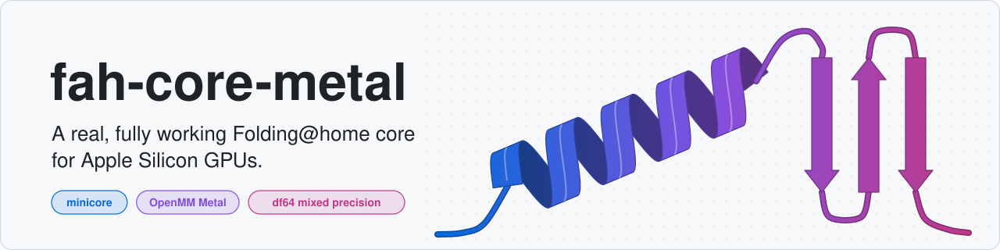
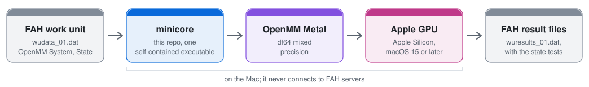

<h1 align="center">
<picture>
  <source media="(prefers-color-scheme: dark)" srcset="docs/figures/banner-dark.svg">
  
</picture>
</h1>

<p align="center">
  <a href="docs/EVIDENCE.md#what-was-tested-and-where"></a>
  <a href="docs/EVIDENCE.md#what-was-tested-and-where"></a>
  <a href="#try-it"></a>
  <a href="https://github.com/openmm/openmm/pull/5488"></a>
  <a href="LICENSE"></a>
  <a href="https://redesignedrobot.github.io/fah-core-metal/"></a>
</p>

Folding@home on Apple Silicon Mac GPUs (M1 and later): an independent, fully working Folding at home core on
OpenMM's Metal platform.

People have asked for Folding@home on Apple GPUs since 2019
([openmm#2489](https://github.com/openmm/openmm/issues/2489)) and 2024
([fah-client-bastet#303](https://github.com/FoldingAtHome/fah-client-bastet/issues/303)). Here it is.
minicore runs Folding@home's own OpenMM work units end to end on the Mac's GPU, through OpenMM's Metal
platform, and folds them to the standard of Folding@home's own core.

<picture>
  <source media="(prefers-color-scheme: dark)" srcset="docs/figures/pipeline-dark.svg">
  
</picture>

*FAH's own work unit in, FAH's own result files out, all on the Mac.*

<picture>
  <source media="(prefers-color-scheme: dark)" srcset="docs/figures/cards-dark.svg">
  
</picture>

<details>
<summary>The five checks as text</summary>

| | Checked against FAH's core 0x27 |
| ---: | --- |
| **21 of 21** | state tests passed on a whole real FAH unit (P18264, 919,221 atoms, 5 ns), as FAH's core 0x27 passed 21 |
| **Six files** | in the result, in core 0x27's order; viewerTop.json, xtcAtoms.csv.bz2 and checkpointIntegrator.xml byte-identical to core 0x27's |
| **101 of 101** | core-parity checks passed, and 65 of 65 failure and stop-resume cases |
| **0.054** | worst state-test force RMSE in kJ/mol/nm, beside CUDA's 0.052, against FAHBench's limit of 5 |
| **16 s** | to fold the bundled test unit on an M3 Ultra after `./build.sh`, so you can check it yourself ([Try it](#try-it)) |

</details>

## Accuracy

<picture>
  <source media="(prefers-color-scheme: dark)" srcset="docs/figures/accuracy-dark.svg">
  
</picture>

*Worst state-test errors, Metal beside CUDA, far inside FAHBench's limits.*

<picture>
  <source media="(prefers-color-scheme: dark)" srcset="docs/figures/drift-dark.svg">
  
</picture>

*Energy drift in NVE, 10 runs each, Metal beside CUDA (Welch t -0.7).*

<picture>
  <source media="(prefers-color-scheme: dark)" srcset="docs/figures/distance-dark.svg">
  
</picture>

*Metal parts from FAH's trajectory as fast as two CUDA runs part from each other.*

## Parity with FAH's core

<picture>
  <source media="(prefers-color-scheme: dark)" srcset="docs/figures/parity-dark.svg">
  
</picture>

Every behaviour FAH's client acts on matches core 0x27. The rest needs FAH's own signing keys or is a
format the client never reads. [docs/PARITY.md](docs/PARITY.md) lists every row.

## Speed

### Same card, like for like

On one NVIDIA RTX 5060 Ti, minicore built for CUDA against FAH's core 0x27, over the same first 11% of
P18264:

| Core | OpenMM | Per 1% |
| --- | --- | ---: |
| FAH's core 0x27 | 8.2.0 | 187 s |
| minicore, CUDA | 8.2.0 | 184 s |
| minicore, CUDA | 8.6.1 | 180 s |

<picture>
  <source media="(prefers-color-scheme: dark)" srcset="docs/figures/speed-dark.svg">
  
</picture>

*minicore keeps pace with FAH's own core on FAH's own hardware.*

On a 5,000-step cut on that card, minicore's viewerTop.json and xtcAtoms.csv.bz2 were byte-identical to
FAH's core's ([run conditions](docs/EVIDENCE.md#one-rtx-5060-ti-core-0x27-against-minicore)).

### On Apple Silicon

The M3 Ultra folded the whole unit in 5.06 h, 182 s per 1% ([run conditions](docs/EVIDENCE.md#speed)).

## Try it

On Apple Silicon with macOS 15 or later, Xcode or the Command Line Tools, git and CMake:

```sh
git clone https://github.com/RedesignedRobot/fah-core-metal.git
cd fah-core-metal
./build.sh
./report.sh
```

`./report.sh` folds the bundled test unit in a temp dir, exits with minicore's exit code (100 is
FINISHED_UNIT) and prints a run report: your Mac's chip, GPU cores, RAM and macOS, the build, the exit
code, the GPU info lines and the state tests, then a link that opens the
[run-report form](https://github.com/RedesignedRobot/fah-core-metal/issues/new?template=run-report.yml) with
them filled in. It sends nothing itself: read the form over and submit it, whether the fold passed or not.

To fold it by hand instead:

```sh
cp -R test/alanine-dipeptide unit
./build/core/minicore -dir unit -gpu-vendor apple -gpu 0; echo "exit $?"
```

The fold logs to `unit/logfile_01.txt`, exits 100 (FINISHED_UNIT) and writes its result to
`unit/wuresults_01.dat`.

Tested Macs: the M3 Ultra on macOS 27.2, and on macOS 27.0.1 a base M3 (10 GPU cores, 16 GB), an M4 Pro
(20 GPU cores) and an M1 Max (32 GPU cores) from run reports
[#5](https://github.com/RedesignedRobot/fah-core-metal/issues/5),
[#7](https://github.com/RedesignedRobot/fah-core-metal/issues/7) and
[#8](https://github.com/RedesignedRobot/fah-core-metal/issues/8). On each the test unit passed all 11 state
tests ([details](docs/EVIDENCE.md#tested-macs)).

## Build it

`./build.sh [-j JOBS] [OUT]` fetches OpenMM with the Metal platform at a pinned commit and links
`OUT/core/minicore`, one self-contained executable. OUT, `./build` by default, must not exist:

```sh
rm -rf build
./build.sh
```

The Command Line Tools alone are enough (no Xcode). If an older install left a partial `c++/v1` directory
in the Command Line Tools, which fails every file with `'cstdint' file not found`, `build.sh` says so and
builds against the SDK's libc++ instead ([CLT-only build](docs/EVIDENCE.md#try-it-and-build-it)).

Packaging it for FAH's client on macOS: [docs/PACKAGING.md](docs/PACKAGING.md) covers the arguments, files
and exit codes, the service user, signing and notarization, and the requirements, each measured or taken
from Apple's documentation.

## FAQ

### Is it as accurate as FAH's core?

Yes. It passed all 21 of the unit's state tests, as FAH's core did, and its errors and drift sit with
CUDA's.

### Can Folding@home use the Apple Silicon GPU?

Yes. minicore runs FAH's real work units on it.

### How fast is it?

On one RTX 5060 Ti, minicore built for CUDA took 184 s per 1% of P18264's first 11% on OpenMM 8.2.0 and
180 s on 8.6.1, where FAH's core 0x27 took 187 s on the same card. On Apple Silicon, the M3 Ultra folded
the whole unit in 5.06 h.

### Can I fold for Folding@home points with it today?

No. FAH signs its cores and their results with its own private key, so that step is FAH's.

## Credits

- [OpenMM](https://openmm.org), by Peter Eastman and the OpenMM contributors, does the molecular dynamics.
- Peter Eastman's Metal platform for OpenMM, [openmm#5488](https://github.com/openmm/openmm/pull/5488),
  is the GPU backend.
- Andrew Thall's "Extended-Precision Floating-Point Numbers for GPU Computation" (2006) describes the
  double-float arithmetic behind the df64 mixed precision.
- [Folding@home](https://foldingathome.org) defines the work units, the client and core 0x27 that this
  core is checked against. Its FAHBench state tests are the ones minicore runs.

## License

The code in this repo is under the MIT License (`LICENSE`). OpenMM's code keeps OpenMM's licenses and
notices. The patches in `patches/` edit OpenMM's files and carry OpenMM's license for them, and
`build.sh` fetches OpenMM's tree. The Metal platform and the xdrfile code linked into minicore are under
the LGPL 3 or later, Apple's metal-cpp header compiled into it under the Apache License 2.0, and the xtc
writer from OpenMM's tree under the MIT License. `NOTICE` lists each part.

fah-core-metal is not affiliated with or endorsed by Folding@home. It never connects to FAH servers. It
reads a work unit from a directory and writes its result into that directory.

Built with Claude Fable 5.1 and Opus 5.5.
