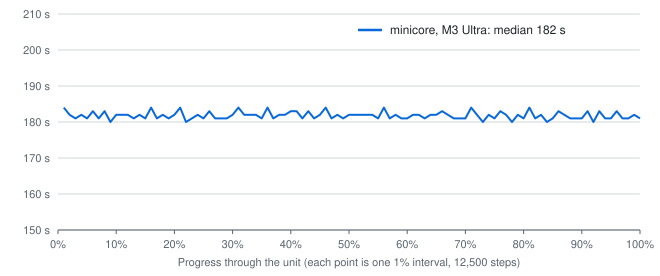
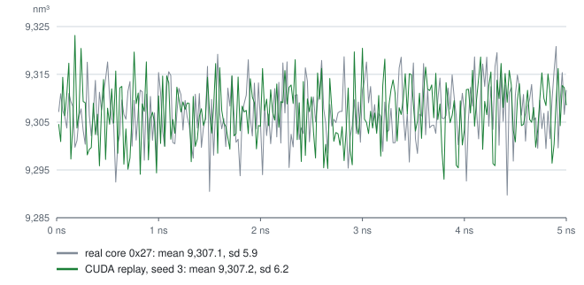

# Evidence

Every number and claim in the README, with the run that produced it and where the raw record is.

The runs on the real unit and the core-parity checks were made in my lab repo, which is private. Paths
below that start with `core-realwu/` or `core-parity/` are under its
`experiments/030-upstream-metal/lanes/`. Each REPORT.md there gives the commands. FAH's unit, its
result files and the real core's logs stay on the bench machine. Neither repo holds them, only
statistics taken from them.

## Which code produced which result

| Result | Code |
| --- | --- |
| Real unit runs, file-by-file parity, the 167 s per 1% night timing | minicore at lab commit 416b78c7 and the commits before it, as each row below names |
| 101 core-parity checks | minicore at lab commit 7a92bbba ("core v3"), state tests against the Reference platform |
| CUDA replay | OpenMM 8.2.0 from conda-forge, `replay.py` in `core-realwu/scripts/` |
| Test unit fold and stop and resume checks (gpuq 2181, 2182) | this repo at 414c69a (source as in 3fc8475, which only sets the scripts' executable bits) |
| P18264 start and resume (gpuq 2180) | this repo's source just before 414c69a, without its stop-on-an-output-step fix, which that run's stops did not reach |
| Fresh-clone build, "Try it" transcript, start-up interrupt | this repo at 3fc8475 (gpuq 2196, 2197) |
| P18264 cut to 5,000 steps and run to the end on the M3 Ultra | the same fresh-clone build (gpuq 2199) |
| P18264 on the M2: 1% from the input, the 5,000-step cut to the end, a start-up interrupt | this repo's source as in 3fc8475, built on the M2 by `build.sh -j 4` (minicore sha256 0af48ff0) |
| Accuracy on four test systems (Figure 5) | Metal: minicore at lab commit 7a92bbba. CUDA: `cuda-ref/scripts/pycore.py`, a Python port of minicore's straight run and FAHBench's state test, on conda-forge OpenMM 8.6.1 |
| Energy drift (Figure 6) | OpenMM's own VerletIntegrator through `drift/scripts/run1ns.py`, no core |
| Core-gap checks, the holdout stop and resume, the second P18264 cut (gpuq 2235, 2236) | this repo's source as in ceb9707, linked by `src/link.sh` against the OpenMM prefix of the fresh clone of 3fc8475 (minicore sha256 5e7cc197761cb69f) |

This repo's minicore is the lab's 416b78c7 reworked after two code reviews (`docs/design-notes.md`).
On a clean run it writes the same files, members and log lines.

## The unit

P18264 run 153 clone 0 gen 272: 919,221 atoms (2,520 solute), 1,250,000 steps of 4 fs (5 ns),
LangevinMiddle, PME, MonteCarloBarostat, mixed precision. One 1% is 12,500 steps.
Source: `core-realwu/REPORT.md`, the paragraph headed "Unit", and `core-realwu/results/unit-layout.txt`.

## Speed

| README figure | Value | Source |
| --- | --- | --- |
| Real core, time per 1% | 192 s | Median of the real run's 1% intervals from its viewer frames 0-99; `core-realwu/results/real/timing.txt`, made by `core-realwu/scripts/realtiming.py`; `core-realwu/REPORT.md` section 5 |
| Real core, time per unit | 5.37 h | 19,330 s wall, 2026-10-15 19:04:41Z to 00:26:51Z; same files |
| M3 Ultra, time per 1% | 167 s | gpuq job 2151, night slot, nice 0, minicore 416b78c7 (binary sha256 8e3c8173). 1% intervals 168, 167, 165, 165, 167 s from host-clock stamps of the progress lines. The load average was 7.14 at the start, above the 3 the night rule asks for. Other work on the machine can only slow a run, so 167 s is conservative. It agrees with the daytime run of minicore 942bac4b (gpuq 2150), whose viewer frames 0-4 came 167 s apart (`core-realwu/results/ultra-62500/viewer-mtimes.txt`). No timing run of this repo's own build was made. `core-realwu/results/night-62500/timing.txt`; `core-realwu/REPORT.md` section 5 |
| M3 Ultra, time per unit | 4.66 h | 26.7 s start-up + 100 x 167 s + 20 checkpoints x 2 s; same file |
| M2, time per 1% | 1,280 s | Viewer frames 1-4 of a 62,500-step run at nice 10, 1,288, 1,279, 1,279, 1,278 s, minicore 942bac4b, by day; `core-realwu/results/m2-62500/files.txt`; `core-realwu/REPORT.md` section 5 |
| M2, time per unit | 35.6 h, 74% of 48 h | 100 x 1,280 s plus start-up and checkpoints; same section |
| M3 Ultra against the real core | 0.87 | 167 / 192 |

`docs/data/speed.csv` holds the real core and M3 Ultra rows, and Figure 2 is drawn from it.

The README gives no M2 speed. Its numbers stay here: 1,280 s per 1% and 35.6 h per unit (74% of the 48 h
timeout) in the lab's run above, and 1,298 s for the first 1% with this repo's build (frames 0 and 1 of a
run from the input on 2026-10-16, nice 0, load average 1.0 mean and 2.5 peak in its first minute, an
interval that also holds the step-0 checkpoint).

| Figure S1 | Value | Source |
| --- | --- | --- |
| Real core, seconds per 1% | 99 intervals between viewer frames 0 and 99, median 192 s, 186 to 199 s | Modification times of the real run's `viewerFrame0.json` to `viewerFrame99.json` on the bench, read with `stat`; the same times `core-realwu/results/real/timing.txt` uses |
| M3 Ultra, seconds per 1% | 168, 167, 165, 165, 167 s | `core-realwu/results/night-62500/timing.txt`, host-clock stamps of the progress lines |

`docs/data/progress.csv` holds both columns.

## Trajectories and volume

| README figure | Value | Source |
| --- | --- | --- |
| Distance from the real frame at step 5,000 | M3 Ultra 0.475 nm, M2 0.479 nm, CUDA seed 1 0.479 nm | `core-realwu/results/frames/real-s1-ultra-m2.tsv`, made by `core-realwu/scripts/frames.py` (solute atoms, minimum image, no fitting); `core-realwu/REPORT.md` section 3 |
| CUDA seed 1 against CUDA seed 3 at step 5,000 | 0.481 nm | `core-realwu/results/frames/s1-vs-s3.tsv` |
| randomSeed 0 | A new seed per Context | The unit's integrator.xml; `core-realwu/REPORT.md` section 3 |
| Box volume over the unit | 9,307.1 nm³ mean for both, sd 5.9 (real) and 6.2 (CUDA seed 3) | 250 frames each; `core-realwu/results/frames/real-s3-full.tsv` and `real-s3-summary.txt` |
| Box volume range, first 62,500 steps | 9,299 to 9,317 nm³ in all four runs | `core-realwu/REPORT.md` section 3 |

`docs/data/distance.csv` (every 5,000 steps to 60,000) and `docs/data/volume.csv` (every 5,000 steps
of the unit) are those tables' columns.

## What was tested and where

| README claim | Count | Source |
| --- | --- | --- |
| The real core folded the whole unit | fah-client 8.5.6, core 0x27 8.2.1 (OpenMM 8.2.0, CUDA), RTX 5060 Ti, Linux, 2026-10-15, exit 100 | `core-realwu/REPORT.md` header; `core-realwu/results/real/real-files.txt` |
| Real-unit state tests on the M3 Ultra | 12 pass, 0 fail | Lines starting "State test at step" in each run's own log: `ultra-62500` 2, `ultra-fin-10000` 3, `wu3-ultra-12500` 1, `ultra-fin4-1000` 2, `ultra-fin5-1000` 2, `night-62500` 2, all under `core-realwu/results/` |
| Real-unit state tests on the M2 | 5 pass, 0 fail | `m2-62500` 2, `m2-fin-5000` 3 |
| 101 core-parity checks on each Mac | 101 of 101 on the M3 Ultra and on the M2 | `core-parity/REPORT.md` section 4, `core-parity/results/metal-*/summary.log`, `core-parity/results/m2-units/summary.log` |
| State tests in those checks | 156 pass, 1 fail on each Mac | Counted in the 27 per-case logs per Mac (`core-parity/results/metal-*/*.log` and `m2-units/*.log`, leaving out `summary.log` and `run-units-*.log`, which repeat lines). The one fail is `gbsa-badstart.log`, whose core.xml sets energyTolerance 1e-9 so that its first test fails |
| This repo's build resumes to the same frames | 101 viewer frames and 100 XTC frames at steps 250 to 25,000, as a straight fold | gpuq jobs 2181 (SIGINT at 50%, resume) and 2182 (19 SIGINTs, each landing on an output step, then a resume each time); state tests 11 pass in the straight fold, 12 and 30 pass in the resumed ones, 0 fail |
| This repo's build on P18264 | Start, SIGINT, resume from the checkpoint, SIGINT: 2 state tests pass, 0 fail, exit 102 both times | gpuq job 2180, test 4 |
| This repo's build, P18264 to the end, M3 Ultra | A copy of the unit with numSteps 5,000 and checkpointFreq 2,500, all else unchanged: exit 100, 101 viewer frames, viewerTop.json sha256 9431b3ab and xtcAtoms.csv.bz2 sha256 616d8e69 as the real run's, wuinfo_01.dat 512 B, the six result members in order with mode 0666 and uid and gid 0, checkpointIntegrator.xml 199 B, stepCount 341,105,271 (input 341,100,271 + 5,000), 3 state tests pass, 0 fail | gpuq job 2199 |
| This repo's build, P18264, M2 | From the input to 1%: viewerTop.json and xtcAtoms.csv.bz2 hashes as above, wuinfo_01.dat 512 B, 1 state test pass. The 5,000-step copy to the end: the same facts as the M3 Ultra's row, 3 state tests pass, 0 fail. SIGINT 3 s into start-up: the four lines, exit 102 | Runs under the M2's job lock on 2026-10-16 |
| This repo's build at ceb9707, P18264 to the end, M3 Ultra | The same 5,000-step copy: exit 100 in 121 s, viewerTop.json sha256 9431b3ab and xtcAtoms.csv.bz2 sha256 616d8e69 as the real run's, wuinfo_01.dat 512 B, 101 viewer frames, one XTC frame at step 5,000, the six members in core 0x27's order, checkpointIntegrator.xml 171 B with sha256 53b47b00 as the real result's member, stepCount 341,105,272 (input 341,100,271 + 5,001, as core 0x27), "Ewald parameters: alpha 2.62826 nx 189 ny 180 nz 160" as core 0x27's science.log, `01/` removed, 3 state tests pass, 0 fail | gpuq job 2235, [core-gap runs](#core-gap-runs) |
| State tests on the real unit, this repo's build | 5 pass on the M3 Ultra (2180 test 4: 2; 2199: 3), 4 pass on the M2 (1; 3), 0 fail | The rows above |
| "The M2, a base 8 GB chip" | Apple M2, 8 GB (8,589,934,592 B from `sysctl hw.memsize`) | The M2 run's own header line |

The state-test counts above come from counting the "State test at step" lines in the raw logs, pass
and FAIL, and not from a harness's summary.

Command for the core-parity count, run in `core-parity/results`:

```
files=$(find metal-gbsa metal-neq metal-tip3p-hmr metal-tip4pew -name '*.log' ! -name summary.log ! -name 'run-units*')
grep -h 'State test at step' $files | grep -c ': pass$'
grep -h 'State test at step' $files | grep -c FAIL
```

and the same with `m2-units` for the M2.

## Core-gap runs

`docs/PARITY.md` cites these as "run `<case>`". The cases are the core-gap lane's `failure.sh`, one
minicore run or a stop and its resume per case, each checking the exit code and one fact in the files
the run left. All ran on the M3 Ultra's GPU through gpuq correctness tickets on 2026-10-16, on the
build in the "Which code" table.

| Units | Cases | Result | Job |
| --- | --- | --- | --- |
| `test/alanine-dipeptide` | 53: straight, 10 unit damages, 14 core.xml cases, 4 bad states and retries, 9 signal cases, 3 checkpoint damages, lock, lifeline, 7 argument cases, 3 file system faults | 52 pass. checkpoint-other-unit failed on a harness bug: it appended a newline after the state's XML root, which OpenMM's reader refuses, so the unit itself failed (114) before the checkpoint check ran | gpuq 2235 |
| fah-gbsa, fah-neq, fah-tip4pew (holdout units) | straight, a SIGINT mid-run, its resume | 9 of 9 pass | gpuq 2235 |
| fah-tip3p-hmr | straight | pass | gpuq 2235 |
| fah-tip3p-hmr | a SIGINT mid-run, its resume | 2 of 2 pass (102, then 100) | gpuq 2236 |
| `test/alanine-dipeptide` | checkpoint-other-unit, the state's stepCount changed by one instead | pass: exit 100, a fresh start after "Could not resume from checkpoint" | gpuq 2236 |
| P18264, the 5,000-step copy | straight to the end | the row "This repo's build at ceb9707" above | gpuq 2235 |

gpuq 2236 exists because the harness was edited while gpuq 2235 ran it, and `sh` reads a script by
offset: tip3p-hmr's stop and resume died on a syntax error after its straight case passed. The fix went
into a copy for 2236. 65 cases in all, 65 pass on the final runs.

## How it matches

Each row of the README's table and of `docs/data/parity.csv` is a row of `core-realwu/REPORT.md`
section 1, which names the evidence file for each.

| README figure | Value | Source row |
| --- | --- | --- |
| Unit container | 512-byte header, then a tar of four files | "wudata_01.dat container" |
| core.xml keys | seven | "core.xml keys" |
| Intervals | 5%, 1%, 0.4% (62,500, 12,500 and 5,000 steps) | "Intervals" |
| State test platform and limits | CPU; force 1e7, energy 1e9 from core.xml | "State test platform", "State test limits" |
| Interrupt at start-up | four lines, exit 102 | "Interrupt during start-up"; for this repo's build, gpuq job 2187 |
| wuinfo_01.dat | 512 B | "wuinfo_01.dat" |
| viewerTop.json | 56,183 B, byte-identical | "viewerTop.json" |
| viewerFrameN.json | 101 frames | "viewerFrameN.json" |
| positions.xtc | 250 frames, 2,520 atoms | "positions.xtc" |
| xtcAtoms.csv.bz2 | 2,824 B, byte-identical | "xtcAtoms.csv.bz2" |
| Result members | six, same order, plain ustar | "wuresults members", "wuresults_01.dat container" |
| Exit | 100 | "Exit" |
| Log shapes | 87 in the real logfile_01.txt, 35 word for word | `core-realwu/scripts/logshape.py` on the real log (`fah-wu/p18264-r153-c0-g272/results/final/logfile_01.txt`) and the logfile_01.txt of gpuq 2235's 5,000-step copy prints "real 87 shapes, minicore 59, shared 35". Before ceb9707 the same on gpuq 2199 and the M2 run printed "minicore 28, shared 19". The 52 left name FAH's build and libraries, the signature check, the client's arguments, the CPU and GPU, the CUDA and OpenCL platforms, and four cbang System rows (CPU ID, Free Memory, Has Battery, On Battery) whose values come from cbang's hardware probes |
| Energy conservation | Metal mixed -0.0010 ± 0.0006, CUDA mixed -0.0001 ± 0.0011 kJ/mol/ps (mean ± SE, 10 seeds each), Welch t -0.7 | Not from core-realwu: `drift-fix/REPORT.md`, Verdict and the drift table (lab commit 3ec69c3c). Metal on fork 90fa9544c, the commit `build.sh` pins, raw `drift-fix/results/raw/mm90fa/s1..s10` and `drift-fix/results/drift-runs.csv`; CUDA is OpenMM 8.6.1, raw `cuda-ref/results/drift/cuda-mixed/` |

## Where it differs

| README claim | Source |
| --- | --- |
| Signed result header | `core-realwu/REPORT.md` section 1 row "wuresults_01.dat container" and section 2 |
| Checkpoint format | Real: section 1 row "Checkpoint files in the work dir"; checkpt.crc's strings in the core (`docs/PARITY.md` row K3). minicore: `src/wufiles.cpp` `writeAtomically` (length and 64-bit FNV-1a footer) and `src/minicore.cpp` `checkpointHeader` |
| OpenMM version strings | Section 1 row "checkpointState.xml.bz2" |
| Log wording, 35 of 87 | Section 1 row "logfile_01.txt" and the "Log shapes" row above |

## Try it and Build it

| README figure | Value | Source |
| --- | --- | --- |
| Test unit | 2,269 atoms, 25,000 steps of 4 fs (100 ps) | `test/make-unit.py`, `test/alanine-dipeptide/core.xml`; the fold's own log line "2269 atoms" |
| Transcript, 16 s | Lines from the fold's standard output, exit 100, 101 viewer frames, 100 XTC frames, state tests 11 pass and 0 fail | gpuq job 2197: `./build/core/minicore -dir unit -gpu-vendor apple -gpu 0` in the fresh clone of 3fc8475 |
| OpenMM commit | 90fa9544c, three patches | `build.sh`, `patches/` |
| Build time, 15 minutes | 906 s: fetch and configure 16 s, build and install 880 s, link 10 s; load average about 70 at the start | gpuq job 2196, `BUILD-INFO` of the fresh clone of 3fc8475 (`git clone --no-local` of this branch). minicore 7,036,640 bytes, sha256 aabfedc0acd41d4e |
| Start-up interrupt on this repo's build | P18264 SIGINT 3 s into start-up: "Caught signal SIGINT(2)", "Exiting, please wait. . .", "ERROR:102: Core startup was interrupted by client.", "Folding@home Core Shutdown: INTERRUPTED", exit 102 | gpuq job 2197 |

## Accuracy (Figure 5)

| README figure | Value | Source |
| --- | --- | --- |
| Test systems | gbsa 2,489 atoms, neq 2,269, tip3p-hmr 29,451, tip4pew 38,876 | `core-parity/REPORT.md` section 3 |
| Tests | 6 per system and arm (step 0 and five checkpoints), against Reference; 72 in all, 72 pass | `core-parity/results/metal-<unit>/<unit>-straight.log` (M3 Ultra), `core-parity/results/m2-units/<unit>-straight.log` (M2), `cuda-ref/results/cuda-mixed/<unit>-straight.log` (RTX 5060 Ti, OpenMM 8.6.1); `cuda-ref/REPORT.md` header and section 1 |
| Worst force RMSE | 0.054 kJ/mol/nm on Metal (tip4pew, both Macs, 0.05438), 0.052 on CUDA (tip4pew, 0.05209); limit 5 | The largest "force RMSE" over each log's "State test at step" lines |
| Worst \|ΔPE\| | 0.61 kJ/mol on Metal (tip3p-hmr, M2, 0.6073), 0.28 on CUDA (tip4pew, 0.2765); limit 10 | The largest "\|dPE\|" over the same lines |

`docs/data/accuracy.csv` holds the worst values per system and arm, read from those logs with a regular
expression over the "State test at step" lines.

## Energy drift (Figure 6)

| README figure | Value | Source |
| --- | --- | --- |
| System and protocol | amber20-dhfr, 23,558 atoms, PME; 10 ps LangevinMiddle, then 1 ns VerletIntegrator NVE at 2 fs, constraint tolerance 1e-8; drift is the least-squares slope of total energy against time | `drift-fix/REPORT.md` section 3; `drift/scripts/run1ns.py` (`np.polyfit(times, energies, 1)`) |
| Metal mixed, fork 90fa9544c | -0.0010 ± 0.0006 kJ/mol/ps, 10 runs | `drift-fix/results/drift-table.md`, raw `drift-fix/results/raw/mm90fa/s1..s10` |
| Metal mixed before openmm#5492, fork 043395619 | -0.0047 ± 0.0009, 10 runs | same table, lane drift's raw files |
| CUDA mixed, OpenMM 8.6.1, RTX 5060 Ti | -0.0001 ± 0.0011, 10 runs | same table, raw `cuda-ref/results/drift/cuda-mixed/` |
| CPU control | +0.0026 ± 0.0008, 4 runs, fork 043395619 | same table |
| Welch t, Metal 90fa9544c against CUDA mixed | -0.7 (14.4 dof) | same table |
| openmm#5492 | "Keep exact positions when reorderAtoms wraps a molecule", merged 2026-10-14; the fork carries it as ef5a25e2c, an ancestor of 90fa9544c | `drift-fix/REPORT.md` Verdict; GitHub |

`docs/data/drift.csv` holds the four rows.

## Parity per Mac (Figure 7)

Each row of `docs/data/parity.csv` is a row of `core-realwu/REPORT.md` section 1. The two columns name
where each Mac showed it.

| Row | M3 Ultra | M2 |
| --- | --- | --- |
| Unit header fields, core.xml keys, output intervals, state test platform and limits | `core-realwu/results/ultra-62500/`, gpuq 2199 | `core-realwu/results/m2-62500/`, the M2 runs of this repo's build |
| State test schedule | `core-realwu/results/ultra-fin-10000/` (step 0 and each checkpoint) | `core-realwu/results/m2-fin-5000/`, `m2-62500` (step 0 and 5%) |
| Interrupt at start-up | gpuq 2197 | The M2 SIGINT run of this repo's build |
| wuinfo_01.dat, viewerTop.json, xtcAtoms.csv.bz2 | gpuq 2199 | The M2 1% and 5,000-step runs |
| viewerFrameN.json, result members and order, result tar format, exit code, OpenMM version strings | gpuq 2199 | The M2 5,000-step run |
| Final step count, checkpointIntegrator.xml, work dir layout | gpuq 2235 | Not rerun. The M2 ran 3fc8475, before ceb9707 changed these three; the change is the same C++ on both Macs and touches no Metal code |
| positions.xtc | `core-realwu/results/ultra-62500/xtc-frames.tsv` | `core-realwu/results/m2-62500/xtc-frames.tsv` |
| Box volume | `core-realwu/REPORT.md` section 3 | same |
| Log sections and order, log wording | `logshape.py` on gpuq 2235's log | `logshape.py` on the M2 5,000-step run's log, 19 of 87 before ceb9707 |
| Checkpoint format | `src/wufiles.cpp`, `src/minicore.cpp`; the same binary on both | same |
| Result header signature, unit signature check | Need FAH's keys; `core-realwu/REPORT.md` section 2 | same |

Counts: 20 match, 3 by design, 2 FAH only, the same on both Macs.

## Which Macs

| README claim | Source |
| --- | --- |
| arm64 only | `src/link.sh`, `-arch arm64` |
| macOS 15.0 or later | `build.sh`, `-DCMAKE_OSX_DEPLOYMENT_TARGET=15.0`, and the comment above it; `src/link.sh` fails a binary whose minos is below 15.0 |
| Metal Shading Language 3.2 | Fork 90fa9544c, `platforms/metal/src/MetalContext.cpp` line 454, `options->setLanguageVersion(MTL::LanguageVersion3_2)` |
| Apple7 and later | The GPU families of Apple Silicon Macs. The Metal platform checks no family; the M3 Ultra and the M2 are the two I ran |

## The opening lines

The two sentences under Figure 1 repeat facts from the sections above: project 18264 with 919,221 atoms
(the unit), the M3 Ultra and the M2 (which Macs), and "matches core 0x27 on every check FAH doesn't
control", which is Figure 7: 20 of 25 items match on both Macs, 3 differ where FAH's design decides and 2
need FAH's keys (parity per Mac). The line under Figure 7 is "what was tested and where": 101 of 101
checks per Mac and every real-unit state test each Mac ran.

## Background and FAQ

| README claim | Source |
| --- | --- |
| openmm#2489 "Future of osx GPU support", 2019-11-28 | `gh api repos/openmm/openmm/issues/2489`: title and created_at |
| fah-client-bastet#303 "Support for Apple's integrated GPUs", 2024-11-05, open | `gh api repos/FoldingAtHome/fah-client-bastet/issues/303`: title, created_at and state, read 2026-10-16 |
| fah-client ran minicore against a local stand-in for FAH's servers and took its results | `core-parity/REPORT.md` section 5 (`loopback.sh`): fah-client master 706d6a0 against a fake work server on the same machine |
| Results carry no FAH signature, nothing connects to FAH's servers | "Where it differs"; `src/` opens no socket |

## Credits and the last line

| README claim | Source |
| --- | --- |
| Andrew Thall, "Extended-Precision Floating-Point Numbers for GPU Computation" (2006) | The df64 operations in the fork's Metal mixed precision follow it; the paper's own title page |
| openmm#5488 "Metal Platform", by Peter Eastman, merged 2026-10-14 | GitHub |
| "Built and tested with Claude Opus 5.5." | The model that wrote this repo and ran its tests |

## The Pages files

`docs/index.html`, `docs/llms.txt` and the Open Graph text repeat sentences of the README word for word,
so each claim there has its source in the sections above. `docs/social.png` repeats Figure 2's hours.

## Detail moved from the README

The README keeps the figures and one line each. The longer text it had is here, unchanged apart from
figure paths and numbers. Figure S1, the progress trace, appears only here.

### Speed

P18264 run 153 clone 0 gen 272: 919,221 atoms, 1,250,000 steps of 4 fs (5 ns), PME, a Monte Carlo
barostat and mixed precision. One 1% is 12,500 steps.

| Machine | Core | Time per 1% | Time per unit |
| --- | --- | ---: | ---: |
| RTX 5060 Ti, Linux | core 0x27 8.2.1 (OpenMM 8.2.0, CUDA mixed), a real FAH run | 192 s | 5.37 h |
| M3 Ultra, macOS 27 | minicore, Metal mixed | 167 s | 4.66 h |

<picture>
  <source media="(prefers-color-scheme: dark)" srcset="figures/speed-dark.svg">
  
</picture>

*Figure 2. Hours per P18264 unit: core 0x27 from the real run's wall clock, minicore from 100 times its
median 1% interval plus start-up and checkpoints (`docs/data/speed.csv`).*

<picture>
  <source media="(prefers-color-scheme: dark)" srcset="figures/progress-dark.svg">
  
</picture>

*Figure S1. Seconds per 1% interval: core 0x27 from the times of its 100 viewer frames across the unit,
the M3 Ultra from the times of its progress lines over the first 5% (`docs/data/progress.csv`).*

The M3 Ultra takes 0.87 times the real core's time per 1%.


### Same science

No two runs of this unit share a trajectory, on any platform. The unit's integrator has randomSeed 0,
which OpenMM reads as "pick a new seed for each Context". So I compared minicore's trajectory with the
real one the way two CUDA runs compare with each other. I replayed the unit twice with OpenMM 8.2.0 in
CUDA mixed precision on the same model of card, with seeds 1 and 3.

<picture>
  <source media="(prefers-color-scheme: dark)" srcset="figures/distance-dark.svg">
  
</picture>

*Figure 3. RMS distance between the 2,520 solute atoms of two runs every 5,000 steps, minimum image and
no fitting: each run against the real one, and CUDA seed 1 against CUDA seed 3
(`docs/data/distance.csv`).*

At step 5,000, the first frame anyone writes, the M3 Ultra's solute is 0.475 nm from the real one and the
M2's 0.479 nm. The two CUDA seeds are 0.481 nm from each other. Metal parts from the real run as fast as
CUDA parts from itself.

<picture>
  <source media="(prefers-color-scheme: dark)" srcset="figures/volume-dark.svg">
  
</picture>

*Figure 4. Box volume at each of the 250 XTC frames of the unit, the real run and the CUDA replay with
seed 3 (`docs/data/volume.csv`).*

Over the whole unit the CUDA replay samples the same box volume as the real run: a mean of 9,307.1 nm³
for both, with a standard deviation of 5.9 for the real run and 6.2 for the replay. Over the first 62,500
steps, the part all four runs share, every run's box stays between 9,299 and 9,317 nm³.


### Accuracy and energy conservation

Core 0x27 checks the GPU against the CPU platform with FAHBench's state test: forces and energies
from the same positions, within limits. I ran it on four test systems at step 0 and at five checkpoints,
on Metal and on CUDA mixed precision, against OpenMM's Reference platform.

<picture>
  <source media="(prefers-color-scheme: dark)" srcset="figures/accuracy-dark.svg">
  
</picture>

*Figure 5. Worst of six state tests per test system against OpenMM's Reference platform, on a log scale
with FAHBench's limits dashed: Metal mixed on each Mac, and CUDA mixed (OpenMM 8.6.1) on an RTX 5060 Ti
(`docs/data/accuracy.csv`).*

The test systems are gbsa (2,489 atoms, implicit solvent), neq (2,269 atoms, a nonequilibrium
CustomIntegrator), tip3p-hmr (29,451 atoms, PME, 4 fs) and tip4pew (38,876 atoms, PME, virtual sites).
All 72 tests passed. The largest force RMSE is 0.054 kJ/mol/nm on Metal and 0.052 on CUDA, against a
limit of 5. The largest |ΔPE| is 0.61 kJ/mol on Metal and 0.28 on CUDA, against a limit of 10.

<picture>
  <source media="(prefers-color-scheme: dark)" srcset="figures/drift-dark.svg">
  
</picture>

*Figure 6. Energy drift of DHFR (23,558 atoms) over 1 ns of NVE at 2 fs: the least-squares slope of each
run's total energy, mean ± SE over independent runs (`docs/data/drift.csv`).*

Metal mixed at the OpenMM commit `build.sh` pins drifts -0.0010 ± 0.0006 kJ/mol/ps. CUDA mixed, the
precision core 0x27 runs, drifts -0.0001 ± 0.0011, and 10 runs each can't tell the two apart (Welch t
-0.7). Before openmm#5492 fixed how OpenMM rewraps molecules, Metal mixed drifted -0.0047 ± 0.0009.


### What was tested and where

- **The real core.** fah-client 8.5.6 ran core 0x27 8.2.1 on an RTX 5060 Ti under Linux and folded the
  whole unit on 2026-10-15 in 5.37 h. Its files are the reference for every check below. I also replayed
  the unit with OpenMM 8.2.0 in CUDA mixed precision on the same model of card.
- **minicore on the M3 Ultra and the M2, under macOS 27.** Each Mac ran the real unit to step 62,500 and
  ran shortened copies to the end, which writes the result files. Every state test on the real unit
  passed: 12 of 12 on the M3 Ultra and 5 of 5 on the M2, with none failed.
- **101 core-parity checks on each Mac.** These cover four smaller test systems and every path a FAH
  core has to survive: a straight run, a pause and resume, SIGKILL, a NaN, a stalled GPU, repeated
  failures, a unit that fails its first test, a corrupted checkpoint, a dead client and bad arguments.
  All 101 passed on both Macs. Across their 27 logs per Mac, 156 state tests passed and 1 failed, on the
  unit that sets its energy limit to 1e-9 so that its first test must fail.
- **This repo's build.** A fresh clone of this repo built with `./build.sh` folds the test unit in
  `test/`, and resumes after a stop to the same 101 viewer frames and 100 XTC frames as a straight run.
  On each Mac it ran P18264 from its input and a 5,000-step copy of it to the end. Its viewerTop.json and
  xtcAtoms.csv.bz2 are byte-identical to the real core's, the result tar holds the same six members, and
  all its state tests passed: 5 of 5 on the M3 Ultra and 4 of 4 on the M2.

The M2, a base 8 GB chip, passes the same checks.


### How it matches

| What | core 0x27 8.2.1 | minicore |
| --- | --- | --- |
| Unit container | 512-byte header, then a tar of core.xml, integrator.xml, state.xml.bz2 and system.xml.bz2 | Reads the header's project, run, clone, gen and payload size, then the tar |
| core.xml | Seven keys | Reads all seven |
| Output intervals | Checkpoint every 5%, viewer frame every 1%, XTC frame every 0.4% | Same |
| State tests | Against the CPU platform at step 0 and every checkpoint, limits from core.xml | Same platform, schedule and limits |
| Interrupt at start-up | Four log lines, exit 102 | Same four lines, exit 102 |
| wuinfo_01.dat | 512 bytes, progress at each 1% | Same layout and values |
| viewerTop.json | 56,183 bytes | Byte-identical |
| viewerFrameN.json | 101 frames, 0 to 100% | Same count, steps and format |
| positions.xtc | 250 frames of the 2,520 solute atoms, unwrapped | Same |
| xtcAtoms.csv.bz2 | 2,824 bytes | Byte-identical |
| Result | A tar of logfile_01.txt, checkpointIntegrator.xml, checkpointState.xml.bz2, positions.xtc, science.log, xtcAtoms.csv.bz2 | The same six members in the same order, in the same tar format |
| Exit | 100, FINISHED_UNIT | 100, FINISHED_UNIT |
| Logs | 87 line shapes in logfile_01.txt | The same sections in the same order |
| Energy conservation, DHFR in NVE, 10 runs of 1 ns | OpenMM 8.6.1 CUDA mixed, the precision core 0x27 runs: -0.0001 ± 0.0011 kJ/mol/ps | Metal mixed at the pinned OpenMM commit: -0.0010 ± 0.0006 kJ/mol/ps |

<picture>
  <source media="(prefers-color-scheme: dark)" srcset="figures/parity-dark.svg">
  
</picture>

*Figure 7. Each file and behaviour of core 0x27's run of P18264, checked on each Mac: blue where minicore
matches, outlined where FAH's own code or keys decide the answer, grey where only FAH's keys can make it
(`docs/data/parity.csv`).*


### Where it differs

Each difference sits where FAH's own code, keys or release choices decide the answer, or names the
hardware.

- **Signed result header.** Core 0x27 puts a 512-byte header with FAH's signature in front of the result
  tar. FAH's private key makes that signature, so minicore returns the tar alone and signs nothing.
- **Checkpoint format.** Core 0x27 writes `01/checkpoint` and guards it with `checkpt.crc`, a file of
  hashes in a format FAH's code defines. minicore writes `01/checkpoint` too: a text header naming the
  unit, OpenMM's checkpoint and a footer with the length and a 64-bit FNV-1a hash. The client reads
  neither.
- **OpenMM version strings.** FAH chose OpenMM 8.2 for core 0x27. minicore builds OpenMM 8.6 with the
  Metal platform, so checkpointState.xml.bz2 says 8.6.
- **Log wording.** 35 of the 87 line shapes in core 0x27's logfile_01.txt appear word for word. The
  rest name FAH's build and libraries, the signature check, the client's arguments, the CPU and GPU,
  and the CUDA and OpenCL platforms, since copying core 0x27's would claim to be it.


### Try it

You need an Apple Silicon Mac with macOS 15 or later, Xcode or the Command Line Tools, git and CMake.

```
git clone https://github.com/RedesignedRobot/fah-core-metal.git
cd fah-core-metal
./build.sh
cp -R test/alanine-dipeptide unit
./build/core/minicore -dir unit -gpu-vendor apple -gpu 0
```

`test/alanine-dipeptide` is alanine dipeptide in 2,269 atoms of water, set up as P18264 is: Amber14 with
TIP3P, PME, hydrogen mass repartitioning, a 4 fs LangevinMiddle step, a barostat and mixed precision.
It runs 25,000 steps (100 ps). On the M3 Ultra the fold of 3fc8475 took 16 s and printed this, shortened:

```
minicore (fah-core-metal), OpenMM 8.6
client arguments: dir unit, version , lifeline 0, gpu-platform , gpu-vendor apple, gpu 0
  Checkpoint write interval: 2500 steps (10%) [10 total]
  JSON viewer frame write interval: 250 steps (1%) [100 total]
  XTC frame write interval: 250 steps (1%) [100 total]
...
Attempting to create Metal context:
  Configuring platform Metal
  Using Metal on Metal Platform and gpu 0
2269 atoms, 6 forces, step size 0.004 ps
property Precision = mixed
    Using CPU platform for reference calculations.
  Comparing forces and energies between initial State and CPU...
State test at step 0: max|dF| 0.1179, rms dF 0.02197, force RMSE 0.01298 kJ/mol/nm (limit 5), |dPE| 0.02607, |dKE| 2.638e-11 kJ/mol (limit 10): pass
  All tests passed.
start-up: system and integrator XML 0.0 s, context 3.8 s, state or checkpoint load and first state test 0.9 s, 4.7 s since exec, footprint 311 MB
Completed 0 out of 25000 steps (0%)
Checkpoint completed at step 0
Completed 250 out of 25000 steps (1%)
...
  Performance since last checkpoint: 980.7661797 ns/day
Average performance: 809.771 ns/day
  Running tests
State test at step 25000: max|dF| 0.06421, rms dF 0.01396, force RMSE 0.008421 kJ/mol/nm (limit 5), |dPE| 0.01138, |dKE| 2.819e-11 kJ/mol (limit 10): pass
  All tests passed.
Checkpoint completed at step 25000
  energy -24553.886020 kJ/mol, footprint 423.4 MB
Simulation completed successfully.
  Writing final state file for return: checkpointState.xml.bz2
done 27500 steps, final energy -24553.886006 kJ/mol, 15.5 s in the core, footprint 427.6 MB
Saving result file logfile_01.txt
Saving result file checkpointIntegrator.xml
Saving result file checkpointState.xml.bz2
Saving result file positions.xtc
Saving result file science.log
Saving result file xtcAtoms.csv.bz2
Folding@home Core Shutdown: FINISHED_UNIT
```

From ceb9707 on, minicore prints nothing. It writes its lines where core 0x27 does, in core 0x27's
words, to `unit/logfile_01.txt` and to science.log inside the result. The unit directory then holds
`wuresults_01.dat`, the result tar the client would return, with logfile_01.txt, wuinfo_01.dat and the
viewer frames beside it. positions.xtc and science.log are in the tar, and `unit/01/` is gone. `test/make-unit.py` rebuilds the unit from OpenMM's own
test PDB.


### Build it

`./build.sh [-j JOBS] [OUT]` fetches OpenMM from
[RedesignedRobot/openmm](https://github.com/RedesignedRobot/openmm) at 90fa9544c, branch
`metal-mixed-master`: OpenMM master with the Metal platform (openmm#5488) and df64 mixed precision. It
applies the three patches in `patches/` and builds OpenMM's Reference, CPU, CPU PME and Metal platforms
as static libraries. Then `src/link.sh` links minicore into one arm64 executable with OpenMM inside and
no plugin directory. The script refuses a binary that links anything outside the OS. On the M3 Ultra a fresh clone builds in
15 minutes at `nice 10` with 6 jobs, on a machine with a load average near 70 from other work.

`OUT` defaults to `./build`. It holds the OpenMM checkout, the CMake tree, the static prefix,
`core/minicore` and `BUILD-INFO`, which records the commit, the patches' hashes, the toolchain and the
sizes. `./build/core/minicore --info` lists the platforms built in.

fah-client main starts a core on an Apple GPU with `-dir <unit id> -suffix 01 -version 8.5.7 -lifeline
<pid> -gpu-platform opencl -gpu-vendor apple -opencl-platform 0 -opencl-device 0 -gpu 0`. minicore takes those, plus `--platform Reference|CPU|Metal` to force a
platform. It never opens a network connection.
